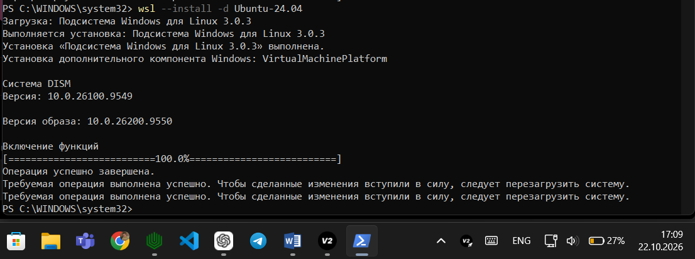
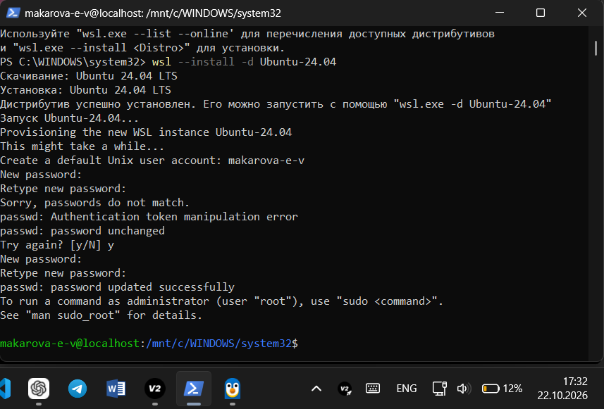
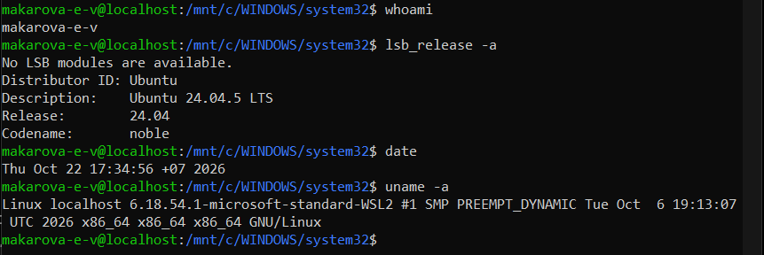
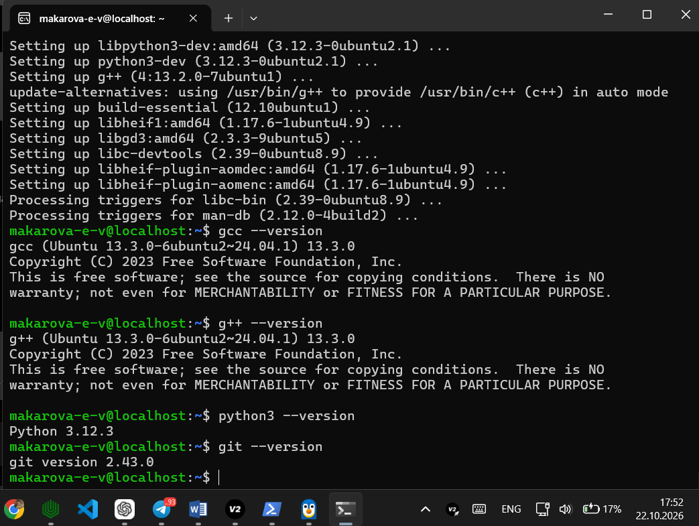
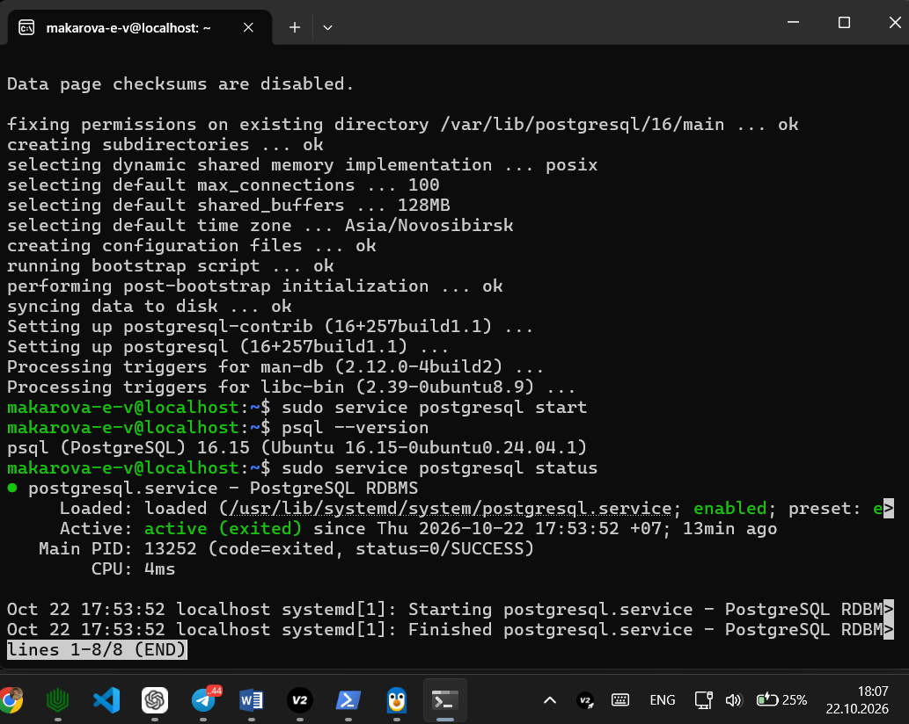
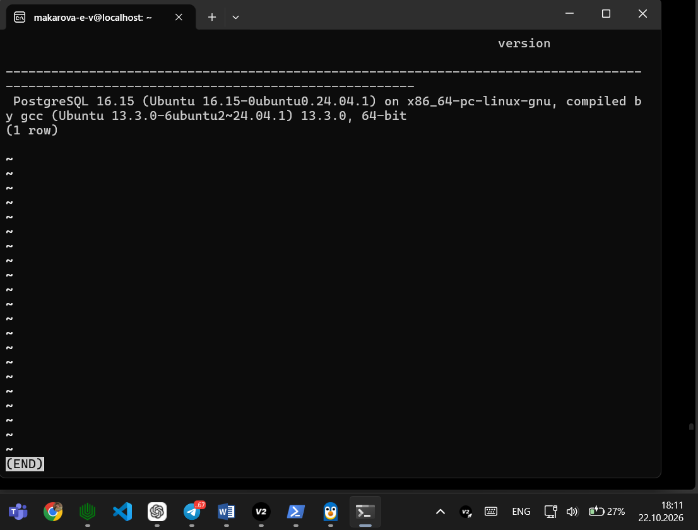
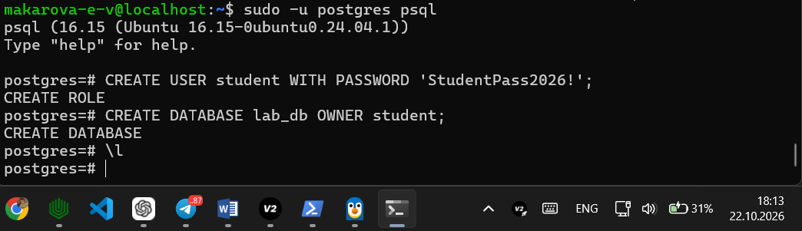
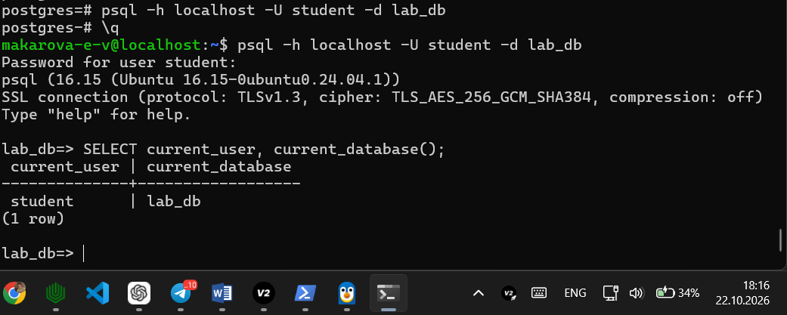

# Развертывание окружения WSL, Ubuntu и PostgreSQL

**Студент:** Макарова Э. В.  
**Пользователь Linux:** `makarova-e-v`  
**Операционная система:** Ubuntu 24.04 LTS  
**Среда:** WSL 2  
**СУБД:** PostgreSQL  

## 1. Установка WSL и Ubuntu

Установлена подсистема Windows для Linux (WSL) и дистрибутив Ubuntu 24.04 LTS.

## 2. Создание пользователя Linux

Создан пользователь `makarova-e-v`.

## 3. Проверка системы

Проверены версия Ubuntu, имя пользователя, дата и сведения о ядре Linux.

## 4. Установка компилятора и интерпретатора

Установлены GCC/G++, Python 3, pip, venv, Git и curl. Версии инструментов проверены в терминале.

## 5. Установка PostgreSQL

Установлен PostgreSQL и проверено состояние службы.

## 6. Проверка сервера базы данных

Получена информация о версии PostgreSQL.

## 7. Создание базы данных

Созданы пользователь `student` и база данных `lab_db`.

## 8. Проверка подключения

Выполнено подключение к `lab_db` под пользователем `student`. Проверены имя пользователя и имя базы данных.

## Вывод

В рамках лабораторной работы развернута среда Linux на базе WSL и Ubuntu 24.04 LTS, установлены инструменты разработки и PostgreSQL. Проверены версия системы, состояние сервера и подключение к созданной базе данных.
